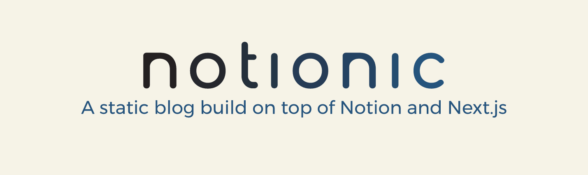

# Notionic

Notionic is a static blog built with **Fumadocs MDX** and **Next.js**, keeping the classic Notionic layout and styling.



## Demo

- Notionic: [https://notionic.vercel.app](https://notionic.vercel.app)
- My Blog: [https://zuolan.me](https://zuolan.me)

## Features

- Local Markdown / MDX content via Fumadocs
- Outline / table of contents
- Theme switch
- Multi-language UI (en / zh)
- Native style comments (Fuma Comment)
- Loading and transition animation
- SEO and Open Graph optimization
- Newsletter support
- Contact Form
- Telegram bot integration
- Craft.do notes archive

## Quick Start

- [Fork](https://github.com/izuolan/notionic/fork) this project
- **Customize `blog.config.js`**
- Add posts under `content/posts/*.md`
- _(Optional)_ Replace `favicon.svg/png/ico` in `public` folder
- Modify `lib/lang.js` with your self introduction
- Deploy on [Vercel](https://vercel.com)

### Markdown frontmatter

```markdown
---
title: My Post Title
date: 2026-01-01
tags: [tag1, tag2]
summary: Optional summary
status: Published
type: Post          # Post | Page | Newsletter | Hidden
cover: /cover.jpg   # optional
fullWidth: false    # optional
---

Your content here…
```

`Hidden` pages with slugs `index`, `newsletter`, and `notes` power the hero intros.

## Development

```bash
pnpm install
pnpm dev
pnpm build
pnpm start
```

## Reference & License

- [Fumadocs](https://fumadocs.dev)
- [Nobelium](https://github.com/craigary/nobelium)

The MIT License.
